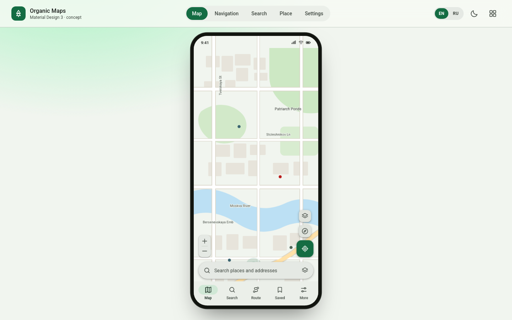
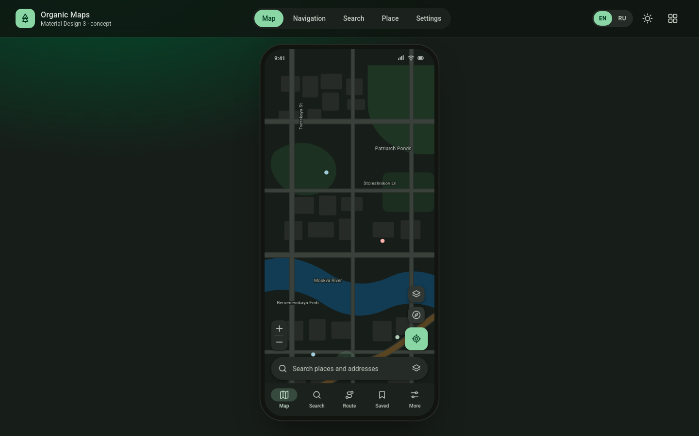

**Language:** English | [Русский](README.ru.md)

# Organic Maps — Material Design 3 redesign

[](https://ivangoldadzonov-ops.github.io/organicmaps-md3/)

| Light theme | Dark theme |
|---|---|
|  |  |

A redesign of [Organic Maps](https://organicmaps.app) following **Material Design 3**: a design system, machine-readable tokens, an interactive prototype, and token implementations ready to port to Android (Compose) and desktop (QML).

> This is a **design project**, not a fork of the application. The app code is unchanged — this repository contains everything the Organic Maps team needs to adopt the new interface: tokens, specifications, screens, and code.

**Organic Maps** is a free offline maps and navigation app built on OpenStreetMap data: no ads, trackers, or data collection. If you use this design or derivative materials, please credit the author:

> Organic Maps Project — https://organicmaps.app

---

## What's inside

| Directory | Contents |
|---|---|
| `tokens/tokens.json` | Single source of truth: colour, typography, shape, elevation, motion, metrics |
| `tokens/css/tokens.css` | The same tokens as CSS custom properties (light and dark schemes) |
| `prototype/` | Interactive prototype: 5 screens, dark theme, all-screens mode, EN/RU localization |
| `docs/design-system.md` | Colour roles, type scale, shape, elevation, motion, and accessibility rules |
| `docs/components.md` | Component specifications: anatomy, states, behaviour |
| `docs/screens.md` | Screen-by-screen rationale and design decisions |
| `docs/migration.md` | Staged migration plan: what to change in Android / QML |
| `android/` | Kotlin + Compose tokens (`Color.kt`, `Type.kt`, `Shape.kt`, `Theme.kt`) |
| `qt/` | QML tokens (`Theme.qml`) for the desktop version |
| `tools/serve.sh`, `tools/serve.ps1` | Local static server for previewing the prototype (Linux/macOS and Windows) |
| `.github/workflows/pages.yml` | Publishes the prototype to GitHub Pages |

## View the prototype

The prototype is made of static files — no build step required.

```bash
# Linux / macOS
./tools/serve.sh 8000
# or any static server from the repository root
python3 -m http.server 8000
# or in PowerShell
powershell -ExecutionPolicy Bypass -File tools/serve.ps1
```

Open <http://localhost:8000/prototype/index.html>.

The prototype includes:

- switching between five screens (top tabs and bottom navigation);
- light and dark themes (button at the top right; settings offers three options, including system);
- **All screens** mode — every layout side by side;
- **EN / RU** language switch in the top bar; English is the default, Russian is also available via `?lang=ru`;
- **Map layers** button in the search bar — reveals quick chips for Terrain, Bike lanes, and Subway;
- working controls: chips, segmented switches, switches, bottom sheet, search, and transport tabs.

Quick links:

- `?theme=dark` — dark theme, `?theme=system` — follow the system;
- `?view=all` — **All screens** mode;
- `?lang=en` — English, `?lang=ru` — Russian;
- `#map`, `#nav`, `#search`, `#place`, `#settings` — deep links to a screen.

Live version: <https://ivangoldadzonov-ops.github.io/organicmaps-md3/>.

Deployment is automatic: a commit to `main` triggers `.github/workflows/pages.yml`. The workflow assembles `_site/` in the same structure as the repository (`prototype/` → `_site/prototype/`, `tokens/` → `_site/tokens/`, root `index.html` → `_site/index.html`), verifies that the required files exist, and publishes the directory via GitHub Actions. The site root serves a redirect page to `prototype/index.html`, so the prototype is available both at the short URL and directly. Repository settings must use **GitHub Actions** as the source (Settings → Pages → Build and deployment → Source: GitHub Actions), not the `main` branch.

## Screens

1. **Map** — search bar, category chips over the map, FAB stack, “Nearby” sheet, bottom navigation.
2. **Navigation** — manoeuvre banner, time and speed badges, sheet with ETA, transport modes, and route alternatives.
3. **Search** — active search field, filters, best-result card, and a list of other places.
4. **Place** — hero map, name, rating and status, quick actions, address and hours, route button.
5. **Settings** — theme, maps and downloads, OpenStreetMap profile for map editing, navigation, privacy, app version.

## Principles

- **The map is the main object.** Everything else is docked panels and sheets, not separate screens.
- **Large targets, large elements.** Touch target is 48 dp, FAB is 56 dp, manoeuvre banner icon is 56 dp.
- **One layer of actions.** Secondary actions go into a bottom sheet instead of a menu.
- **Privacy is visible in the interface.** No purchase or ad banners; the “No trackers” state is shown directly in settings.
- **Dark theme is a first-class theme**, including its own map style.

## Tokens at a glance

The colour scheme is built on MD3 tonal palettes from a single source — the Organic Maps brand green `#146C43`.

| Role | Light | Dark |
|---|---|---|
| `primary` | `#146C43` | `#8BD6A5` |
| `primaryContainer` | `#A6F2C1` | `#00522F` |
| `secondary` | `#4E6355` | `#B4CCBA` |
| `tertiary` (water, cafes) | `#3A6470` | `#A2CDDC` |
| `surface` | `#F7FBF5` | `#0F1511` |
| `surfaceContainerHigh` | `#E5E9E4` | `#252B26` |
| park on map | `#CDE8C4` | `#1E3524` |
| water on map | `#B6DEF5` | `#12405A` |

Full list in `tokens/tokens.json` and `tokens/css/tokens.css`.

## Implementation

1. **Tokens** — copy `android/` and `qt/` into the project and connect the theme (step-by-step in `docs/migration.md`).
2. **Map style** — the map palette values live in `tokens.json → mapSymbols`; applying them requires rebuilding styles in `data/` (see `docs/STYLES.md` in the main Organic Maps repository).
3. **Screens** — specifications in `docs/screens.md`, components in `docs/components.md`.
4. **Feedback** — open an issue or discussion in this repository.

## License

Code and design artifacts are under the **Apache License 2.0** (see `LICENSE`). Tokens may be freely ported into the application.

Map data in Organic Maps itself is distributed separately (`DATA_LICENSE.txt` in the main repository) — this project neither contains nor modifies it.

## Contributing

Ideas, fixes, and feedback are welcome in this repository’s Issues and Discussions. See [CONTRIBUTING.md](CONTRIBUTING.md) for details.
